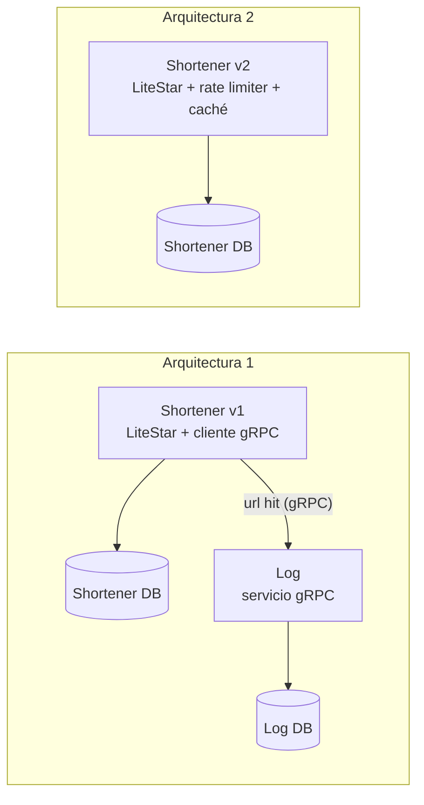

# INF326 — Tarea 2: acortador de URLs

Este repositorio implementa dos arquitecturas de un acortador de URLs en Python 3.12 con LiteStar, SQLite y `uv`. La arquitectura 1 responde con una redirección temporal (HTTP 302) y registra cada visita en un servicio gRPC. La arquitectura 2 responde con una redirección permanente (HTTP 301), guarda las respuestas en un caché y limita las peticiones de cada IP. El diseño detallado está en [docs/architecture.md](docs/architecture.md) y la discusión de trade-offs en [docs/tradeoffs.md](docs/tradeoffs.md).

## Integrantes

| Nombre | Rol |
| --- | --- |
| Andrés Araya Díaz | 202287004-4 |
| Baltazar Portilla Reyes | 202173112-1 |

## Requisitos previos

El proyecto necesita Docker y Docker Compose, conexión a internet para la primera construcción y los puertos locales 8443 y 8444 libres. Python y las dependencias se instalan dentro de las imágenes. Los procedimientos de este README se probaron con Docker 29.7.2 y Docker Compose v5.5.0 en Linux/amd64 (WSL2 con Docker Desktop). En esa prueba, la primera construcción tardó unos 8 minutos, porque descarga las imágenes base y las dependencias.

## Ejecución

Este comando, ejecutado en la raíz del repositorio, construye las imágenes y levanta los servicios:

```sh
docker compose up -d --build --wait
```

La arquitectura 1 queda disponible en `https://localhost:8443` y la arquitectura 2 en `https://localhost:8444`. Al arrancar, Compose genera una CA local y los certificados HTTPS. Para que `curl` confíe en ellos, hay que copiar la CA:

```sh
docker compose cp certificates:/certs/ca.crt ./ca.crt
```

`docker compose down` detiene los servicios y conserva los datos.

## API

`POST /urls` crea una URL corta:

```sh
curl --cacert ca.crt https://localhost:8443/urls \
  -H 'Content-Type: application/json' \
  -d '{"long_url":"https://usm.cl/informatica/"}'
```

El servicio responde con HTTP 201 y un JSON con `id`, `hash`, `long_url` y `short_url`. El primer registro recibe el identificador `597652313` y el hash `eRgfR`.

La URL larga debe incluir el esquema `http://` o `https://`. Si no lo incluye, como el ejemplo `usm.cl/informatica/...` del enunciado, el servicio no crea el enlace y responde HTTP 400 con este cuerpo:

```json
{"status_code":400,"detail":"Validation failed for POST /urls","extra":[{"message":"Input should be a valid URL, relative URL without a base","key":"long_url"}]}
```

En ese caso hay que enviarla con el esquema, por ejemplo `https://usm.cl/informatica/...`.

`GET /HASH` redirige a la URL original:

```sh
curl --cacert ca.crt -i https://localhost:8443/eRgfR
```

La arquitectura 1 responde con `302` y `Cache-Control: no-store`. La arquitectura 2, en el puerto 8444, responde con `301` y `Cache-Control: public, max-age=60`. Cada arquitectura tiene su propia base de datos.

| Situación | Respuesta |
| --- | --- |
| La URL es válida. | 201 |
| La URL es inválida o carece de esquema HTTP/HTTPS. | 400 |
| La URL normalizada supera 2083 caracteres, por ejemplo por la codificación de caracteres no ASCII. | 400 |
| La URL pertenece al propio acortador. | 400 |
| El hash es desconocido. | 404 |
| El cliente agotó su cuota en la arquitectura 2. | 429 |
| La arquitectura 1 falló al registrar la visita. | 503 |

## Arquitectura



En la arquitectura 1, el acortador lee la URL, envía al servicio Log un evento `url hit` con el hash del enlace corto, la URL larga y la hora UTC de la visita, y redirige cuando Log confirma la escritura. En la arquitectura 2, el rate limiter de LiteStar controla las peticiones de cada IP, y el caché en memoria guarda las redirecciones durante `CACHE_TTL` segundos. Docker Compose despliega todos los servicios en un mismo nodo, con TLS entre ellos.

SQLite asigna los `id` con una secuencia que comienza en `597652313` y aumenta de uno en uno. El `hash` es la codificación base62 del `id`, con el mismo alfabeto de `pybase62`. El contrato gRPC está en `proto/shortener/rpc/hits.proto`. [docs/architecture.md](docs/architecture.md) relaciona cada servicio con las figuras del enunciado y describe los contratos, el comportamiento ante fallas y las decisiones de diseño.

## Verificar el funcionamiento

Con los servicios levantados y algunas visitas hechas, Log escribe una línea por cada evento `url hit` que recibe:

```sh
docker compose logs log
```

```text
INFO:     shortener.log_service - url hit recorded: hash=eRgfR url=https://usm.cl/informatica/ visited_at=2026-11-16T17:42:45.286000+00:00
```

Este comando lee la Log DB en modo de solo lectura y muestra las visitas de cada enlace corto y las últimas registradas:

```sh
docker compose exec log python -m shortener.hits_report
```

En la arquitectura 2, el handler escribe `Resolved <hash> from Shortener DB` solo cuando consulta la base. Tras varias visitas seguidas al mismo hash, `docker compose logs shortener-v2` muestra una sola de esas líneas, porque el resto se respondió desde el caché. Las cabeceras `RateLimit-Remaining` de cada respuesta muestran la cuota que queda, y al agotarla el servicio responde 429.

## Configuración

Los valores predeterminados funcionan sin cambios. Para modificarlos, se copia `.env.example` a `.env` y se editan las variables.

| Variable | Valor predeterminado | Uso |
| --- | --- | --- |
| `V1_PORT`, `V2_PORT` | `8443`, `8444` | Puertos HTTPS de cada arquitectura. |
| `V1_PUBLIC_BASE_URL`, `V2_PUBLIC_BASE_URL` | `https://localhost:8443`, `https://localhost:8444` | Origen de las URLs cortas de cada arquitectura. |
| `GRPC_TIMEOUT` | `2` | Segundos de espera máxima por cada registro de visita. |
| `CACHE_TTL` | `60` | Segundos de vigencia del caché del servidor y del `max-age` del 301 en la arquitectura 2. |
| `RATE_LIMIT_REQUESTS` | `60` | Peticiones por IP y por minuto en la arquitectura 2. Es el SLA declarado de la entrega; [docs/tradeoffs.md](docs/tradeoffs.md) explica sus límites. |

## Pruebas

Las pruebas unitarias y smoke se ejecutan dentro de Docker:

```sh
docker compose --profile test run --build --rm --no-deps tests
```

Las pruebas E2E se ejecutan contra los servicios en funcionamiento. Conviene usar un proyecto Compose aparte, porque agotan la cuota de la arquitectura 2:

```sh
V1_PORT=18443 V2_PORT=18444 \
V1_PUBLIC_BASE_URL=https://localhost:18443 V2_PUBLIC_BASE_URL=https://localhost:18444 \
  docker compose -p inf326-e2e up -d --build --wait
docker compose -p inf326-e2e --profile test run --build --rm --no-deps tests \
  uv run --no-sync pytest -m e2e
docker compose -p inf326-e2e down
```

## Uso desde Windows (PowerShell)

Los comandos `docker compose` de este README funcionan igual en PowerShell. Para `curl` hay tres diferencias con bash:

- En Windows PowerShell 5.1, `curl` es un alias de `Invoke-WebRequest`, que no acepta las opciones de curl. Hay que escribir `curl.exe`, el curl incluido en Windows 10 y 11.
- PowerShell 5.1 quita las comillas dobles de un JSON escrito en la línea de comandos antes de pasarlo a `curl.exe`. Por eso conviene guardar el cuerpo en un archivo y enviarlo con `--data-binary`.
- `curl.exe` de Windows comprueba si el certificado fue revocado, y la CA local de este proyecto no publica esa información, así que la conexión falla con `the revocation status is unknown`. La opción `--ssl-no-revoke` omite solo esa comprobación: el certificado se sigue validando con `ca.crt`.

Creación y visita de un enlace:

```powershell
docker compose cp certificates:/certs/ca.crt ./ca.crt
Set-Content -Path body.json -Value '{"long_url":"https://usm.cl/informatica/"}' -Encoding ascii
curl.exe --ssl-no-revoke --cacert ca.crt https://localhost:8443/urls -H "Content-Type: application/json" --data-binary "@body.json"
curl.exe --ssl-no-revoke --cacert ca.crt -i https://localhost:8443/eRgfR
```

Pruebas E2E. Las variables de entorno se fijan para la sesión y se eliminan al final, para que un `docker compose up` posterior vuelva a usar los puertos predeterminados:

```powershell
$env:V1_PORT = "18443"; $env:V2_PORT = "18444"
$env:V1_PUBLIC_BASE_URL = "https://localhost:18443"; $env:V2_PUBLIC_BASE_URL = "https://localhost:18444"
docker compose -p inf326-e2e up -d --build --wait
docker compose -p inf326-e2e --profile test run --build --rm --no-deps tests uv run --no-sync pytest -m e2e
docker compose -p inf326-e2e down
Remove-Item Env:V1_PORT, Env:V2_PORT, Env:V1_PUBLIC_BASE_URL, Env:V2_PUBLIC_BASE_URL
```

## Consideraciones de implementación

La arquitectura 1 responde 503 si el servicio Log falla o tarda más que `GRPC_TIMEOUT`, y su `/health` también responde 503 mientras Log está caído. Cuando Log no confirma una visita, `shortener-v1` registra una advertencia con el código gRPC. La arquitectura 2 guarda el caché y las cuotas en memoria, así que ambos se vacían al reiniciar el servicio, y purga las entradas vencidas cada 60 segundos. Detrás de los puertos publicados por Docker, todas las peticiones del host llegan al rate limiter con la IP del gateway de la red de Compose y comparten una cuota.

Pydantic normaliza las URLs antes de guardarlas: el esquema y el host quedan en minúsculas y los caracteres no ASCII se codifican. El límite de 2083 caracteres se aplica a la URL normalizada, el mismo que aplica Log al validar el evento. Una base de Log creada antes de que el evento incluyera el hash se actualiza al arrancar el servicio, y sus visitas anteriores quedan sin hash.

Los cambios pasan por hooks de pre-commit con Ruff, que se instalan con `uvx --from pre-commit==4.7.0 pre-commit install`.
