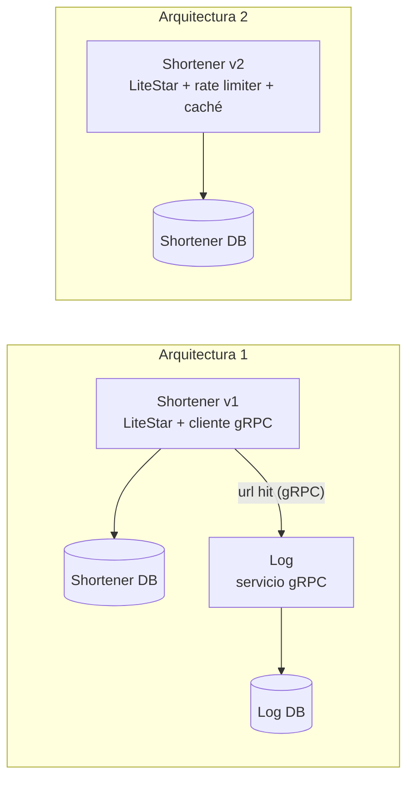

# INF326 — Tarea 2: acortador de URLs

Este repositorio implementa dos arquitecturas de un acortador de URLs en Python 3.12 con LiteStar, SQLite y `uv`. La arquitectura 1 responde con una redirección temporal (HTTP 302) y registra cada visita en un servicio gRPC. La arquitectura 2 responde con una redirección permanente (HTTP 301), guarda las respuestas en un caché y limita las peticiones de cada IP. La discusión de trade-offs está en [docs/tradeoffs.md](docs/tradeoffs.md) y el enunciado original en [docs/2026_INF_326_Arquitectura_de_Software_Tarea_2.pdf](docs/2026_INF_326_Arquitectura_de_Software_Tarea_2.pdf).

## Integrantes

| Nombre | Rol |
| --- | --- |
| Andrés Araya Díaz | 202287004-4 |
| Baltazar Portilla Reyes | 202173112-1 |

## Requisitos previos

El proyecto necesita Docker con BuildKit y Docker Compose con soporte para perfiles y para `up --wait`. Se probó con Docker 29.6.2 y Compose 5.3.1 en Linux/amd64. Los servicios usan los puertos locales 8443 y 8444, y los ejemplos de la API usan `curl`.

Python y las dependencias se instalan dentro de las imágenes. Al construirlas, Docker parte de una imagen base fijada por digest, instala las versiones que fija `uv.lock` y genera los módulos protobuf.

## Ejecución

Este comando, ejecutado en la raíz del repositorio, construye las imágenes y levanta los servicios:

```sh
docker compose up -d --build --wait
docker compose ps
```

Al arrancar, el servicio `certificates` genera una CA local y un certificado de servidor. La arquitectura 1 queda disponible en `https://localhost:8443` y la arquitectura 2 en `https://localhost:8444`, y ambas exponen `/health` para comprobar su estado. El servicio de registro gRPC solo es accesible dentro de la red de Compose. Cada acortador y el registro guardan sus datos en volúmenes separados.

El navegador desconoce la CA local. Para verificar los certificados desde el host, hay que copiar la CA y pasársela a `curl`:

```sh
docker compose cp certificates:/certs/ca.crt ./ca.crt
curl --cacert ca.crt https://localhost:8443/health
curl --cacert ca.crt https://localhost:8444/health
```

Git ignora el archivo `ca.crt`.

`docker compose down` detiene los servicios y conserva los volúmenes con los datos:

```sh
docker compose down
```

El servicio `certificates` reutiliza los certificados mientras les quede más de un día de vigencia. Si les queda menos, los renueva en el siguiente `docker compose up`. Si los servicios ya estaban en ejecución durante la renovación, hay que recrearlos para que carguen los certificados nuevos y volver a copiar la CA:

```sh
docker compose up -d --force-recreate --wait
docker compose cp certificates:/certs/ca.crt ./ca.crt
```

## API

`POST /urls` crea una URL corta. Este ejemplo la crea en la arquitectura 1:

```sh
curl --cacert ca.crt https://localhost:8443/urls \
  -H 'Content-Type: application/json' \
  -d '{"long_url":"https://usm.cl/informatica/"}'
```

El servicio responde con HTTP 201 y un JSON con `id`, `hash`, `long_url` y `short_url`. En una base vacía, el primer registro recibe el identificador `597652313` y el hash `eRgfR`. Ese hash coincide con el ejemplo `usm.cl/eRgfR` del enunciado porque `shortener/domain.py` codifica en base62 con el mismo alfabeto predeterminado de `pybase62`, formado por dígitos, mayúsculas y minúsculas.

`GET /HASH` resuelve una URL corta. En este comando, `HASH` se reemplaza por el valor recibido:

```sh
curl --cacert ca.crt -i https://localhost:8443/HASH
```

La arquitectura 1 responde con `302`, la cabecera `Location` y `Cache-Control: no-store`. La arquitectura 2 atiende en el puerto 8444 y responde con `301` y `Cache-Control: public, max-age=60`. Cada arquitectura tiene su propia base, de modo que un hash creado en una de ellas solo existe en esa arquitectura.

La API responde según la situación:

| Situación | Respuesta |
| --- | --- |
| La URL usa HTTP o HTTPS y es válida. | 201 con la nueva URL corta |
| El cuerpo es inválido, o la URL carece de esquema, usa otro protocolo o supera los 2083 caracteres. | 400 |
| El hash es desconocido. | 404 |
| El método está fuera de la API, como `HEAD` sobre una URL corta. | 405 |
| El cliente agotó su cuota en la arquitectura 2. | 429 |
| La arquitectura 1 falló al registrar la visita en el servicio gRPC. | 503, sin redirección |

Cada `POST` crea una equivalencia nueva, aunque la URL ya exista. La URL debe incluir su esquema, como en `https://usm.cl/`. Pydantic guarda los dominios internacionales en punycode y codifica con porcentajes los caracteres no ASCII de la ruta y de la query. Al resolver una URL corta, el acortador ignora los parámetros de consulta que traiga, como `?utm_source=x`.

## Arquitectura

Docker Compose despliega todos los componentes en un mismo nodo. Cada arquitectura guarda sus URLs en su propia base SQLite dentro de un volumen persistente. Los componentes se comunican por TLS con certificados de la CA local.



En la arquitectura 1, `GET /{hash}` lee la URL de la base, envía el evento `url hit` al servicio Log y espera su confirmación antes de responder 302 con `no-store`. En la arquitectura 2, el rate limiter de LiteStar revisa cada petición antes de resolverla. Luego, el caché en memoria guarda las respuestas 301 durante `CACHE_TTL` segundos, con la ruta como clave.

`ShortenerService` contiene la lógica del dominio. `create_app` le entrega sus adaptadores, `SQLiteURLRepository` y `GrpcHitLogger`, mediante inyección de dependencias, y las pruebas reemplazan esos adaptadores por dobles.

La siguiente tabla indica la fuente y el significado de cada campo de la API y del evento gRPC. El contrato del evento está en `proto/shortener/rpc/hits.proto`.

| Campo | Fuente y significado |
| --- | --- |
| `id` | SQLite lo asigna con una secuencia propia de cada arquitectura, que comienza en `597652313` y aumenta de uno en uno. |
| `hash` | El acortador calcula la codificación base62 del `id` en la misma transacción que inserta el registro. |
| `long_url` | El cliente envía la URL, Pydantic la normaliza y el acortador guarda la forma normalizada sin descargar la página. |
| `short_url` | El acortador concatena `PUBLIC_BASE_URL` y el hash. |
| `url` del evento | El acortador envía la `long_url` guardada, que coincide con la cabecera `Location`. |
| `visited_at` del evento | El acortador toma la hora UTC de su reloj después de encontrar el hash y antes de enviar el evento. La hora marca la resolución en el acortador y precede a la visita del navegador al destino. |

El evento contiene solo la URL y la hora. El hash y los datos del visitante quedan fuera del registro.

## Configuración

Compose trae valores predeterminados que permiten ejecutar el proyecto tal como está. Para cambiarlos, se copia `.env.example` a `.env` y se editan las variables:

```sh
cp .env.example .env
```

| Variable de Compose | Valor predeterminado | Uso |
| --- | --- | --- |
| `V1_PORT` | `8443` | Define el puerto HTTPS que publica la arquitectura 1. |
| `V2_PORT` | `8444` | Define el puerto HTTPS que publica la arquitectura 2. |
| `V1_PUBLIC_BASE_URL` | `https://localhost:8443` | Define el origen de las URLs cortas de la arquitectura 1. |
| `V2_PUBLIC_BASE_URL` | `https://localhost:8444` | Define el origen de las URLs cortas de la arquitectura 2. |
| `GRPC_TIMEOUT` | `2` | Fija el tiempo máximo, en segundos, de cada llamada al registro. |
| `CACHE_TTL` | `60` | Fija la vigencia, en segundos, del caché del servidor y del navegador en la arquitectura 2. |
| `RATE_LIMIT_REQUESTS` | `60` | Fija el máximo de peticiones por IP y por minuto en la arquitectura 2. |

Al cambiar un puerto, también hay que cambiar la URL pública correspondiente. Los certificados generados cubren `localhost`, `127.0.0.1` y los nombres internos de los servicios. Otro dominio necesita certificados emitidos para ese nombre.

## Pruebas

Las pruebas comprueban el comportamiento funcional del sistema: respuestas HTTP, persistencia, TLS y concurrencia. La capacidad y la latencia quedan fuera de su alcance.

Estos comandos construyen la imagen de pruebas y ejecutan las pruebas unitarias y smoke sin levantar los servicios:

```sh
docker compose --profile test build tests
docker compose --profile test run --rm --no-deps tests
```

Para ejecutar un solo nivel, se pasa la ruta o el marcador a `pytest`:

```sh
docker compose --profile test run --rm --no-deps tests uv run --no-sync pytest tests/unit
docker compose --profile test run --rm --no-deps tests uv run --no-sync pytest -m smoke
```

Las pruebas smoke levantan LiteStar y un servidor gRPC con TLS dentro del contenedor, usando archivos temporales y dependencias inyectadas.

Las pruebas E2E se ejecutan contra los contenedores reales y siguen cada redirección hasta un servidor HTTP local de pruebas, por lo que solo dependen de servicios del propio proyecto. Conviene ejecutarlas en un proyecto Compose separado, que aísla sus datos y sus cuotas:

```sh
V1_PORT=18443 V2_PORT=18444 \
V1_PUBLIC_BASE_URL=https://localhost:18443 V2_PUBLIC_BASE_URL=https://localhost:18444 \
  docker compose -p inf326-e2e up -d --build --wait
docker compose -p inf326-e2e --profile test run --build --rm --no-deps tests \
  uv run --no-sync pytest -m e2e
docker compose -p inf326-e2e down
```

La suite E2E agota a propósito la cuota de la arquitectura 2. Para repetirla con los servicios en ejecución, primero hay que recrear `shortener-v2`:

```sh
V2_PORT=18444 V2_PUBLIC_BASE_URL=https://localhost:18444 \
  docker compose -p inf326-e2e up -d --force-recreate --wait shortener-v2
```

Las E2E leen la base del registro con una conexión SQLite de solo lectura. El volumen montado permite que SQLite cree los archivos auxiliares que necesita para leer una base en modo WAL.

Para comprobar una instalación limpia, se construyen las imágenes sin caché a partir de los archivos versionados:

```sh
git archive --format=tar HEAD | docker build --no-cache --target test -t inf326-shortener:test -
git archive --format=tar HEAD | docker build --no-cache --target runtime -t inf326-shortener:runtime -
docker run --rm inf326-shortener:test uv run --no-sync pytest
```

Esta comprobación se ejecutó el 10 de noviembre de 2026 con Docker 29.6.2 y Compose 5.3.1. Pasaron 56 pruebas unitarias y smoke, y 2 pruebas E2E sobre volúmenes nuevos.

## Calidad del código

`uv` administra las dependencias y `uv.lock` fija sus versiones. El Dockerfile reutiliza la caché de dependencias entre construcciones, genera los módulos protobuf y separa las herramientas de prueba de la imagen de ejecución. La imagen de ejecución contiene solo el entorno virtual y el código, y los servicios arrancan con el Python de ese entorno. Todos los contenedores corren con un usuario sin privilegios.

Los hooks de pre-commit se instalan y ejecutan en el host con `uv`:

```sh
uvx --from pre-commit==4.7.0 pre-commit install
uvx --from pre-commit==4.7.0 pre-commit run --all-files
```

Los hooks revisan los espacios y finales de archivo, la sintaxis de YAML, JSON y TOML, los conflictos de merge y el código Python con Ruff. Git ignora `AGENTS.md` y `docs/tasks/`, que son documentación local.

## Consideraciones de implementación

Las operaciones de SQLite usan transacciones, modo WAL y consultas parametrizadas, y la columna `hash` tiene una restricción única. Una prueba inserta URLs desde varios hilos y comprueba que los identificadores sean distintos y consecutivos.

La arquitectura 1 espera la confirmación del registro antes de redirigir y responde 503 si el registro falla. Un timeout o una falla de red puede ocurrir después de que el servicio Log guardó el evento, así que un 503 puede coexistir con un evento registrado. `GRPC_TIMEOUT` limita solo la llamada gRPC, y la petición HTTP completa incluye además la lectura de la base.

`/health` comprueba la base de URLs de cada acortador. En la arquitectura 1, también espera hasta `GRPC_TIMEOUT` a que el canal gRPC con el registro esté listo y responde 503 si sigue sin conexión, porque en ese estado la arquitectura 1 tampoco puede redirigir. El contenedor del registro tiene su propia comprobación de salud por TLS.

La arquitectura 2 guarda el caché y las cuotas en la memoria de su proceso. Al reiniciarlo, ambos se vacían y las URLs permanecen en el volumen.

El rate limiter identifica a cada cliente por la IP de la conexión TCP e ignora `X-Forwarded-For`. Excluye `/health` y cuenta también las respuestas servidas desde el caché. En el log de acceso de la arquitectura 2, las peticiones del host a `localhost` y `127.0.0.1` aparecen con la IP del gateway de la red de Compose (`172.20.0.1`), y las de otro contenedor con la IP de ese contenedor. Por lo tanto, todos los clientes que entran por el puerto publicado comparten una sola cuota. Para tener cuotas por cliente, un despliegue real requiere un proxy inverso de confianza y configurar uvicorn con `proxy_headers` y con `forwarded_allow_ips` restringido a ese proxy.

El alcance cubre crear y resolver URLs cortas, como pide el enunciado, y deja fuera la autenticación, la edición y la eliminación de URLs. Las páginas de destino pueden cambiar o desaparecer por su cuenta, y el acortador sigue redirigiendo a la URL guardada.
