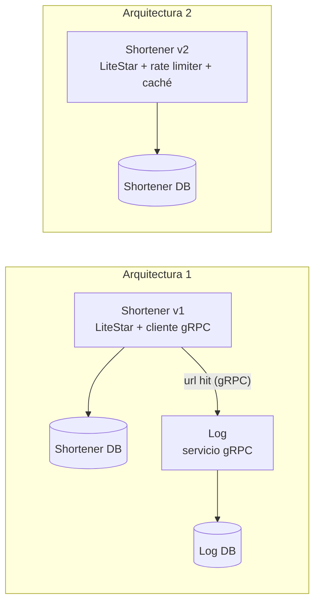

# INF326 — Tarea 2: acortador de URLs

Este repositorio implementa dos arquitecturas de un acortador de URLs en Python 3.12 con LiteStar, SQLite y `uv`. La arquitectura 1 responde con una redirección temporal (HTTP 302) y registra cada visita en un servicio gRPC. La arquitectura 2 responde con una redirección permanente (HTTP 301), guarda las respuestas en un caché y limita las peticiones de cada IP. La discusión de trade-offs está en [docs/tradeoffs.md](docs/tradeoffs.md).

## Integrantes

| Nombre | Rol |
| --- | --- |
| Andrés Araya Díaz | 202287004-4 |
| Baltazar Portilla Reyes | 202173112-1 |

## Requisitos previos

El proyecto necesita Docker y Docker Compose, y los puertos locales 8443 y 8444 libres. Python y las dependencias se instalan dentro de las imágenes.

## Ejecución

Este comando, ejecutado en la raíz del repositorio, construye las imágenes y levanta los servicios:

```sh
docker compose up -d --build --wait
```

La arquitectura 1 queda disponible en `https://localhost:8443` y la arquitectura 2 en `https://localhost:8444`. Al arrancar, Compose genera una CA local y los certificados HTTPS. Para que `curl` confíe en ellos, hay que copiar la CA:

```sh
docker compose cp certificates:/certs/ca.crt ./ca.crt
```

`docker compose down` detiene los servicios y conserva los datos.

## API

`POST /urls` crea una URL corta:

```sh
curl --cacert ca.crt https://localhost:8443/urls \
  -H 'Content-Type: application/json' \
  -d '{"long_url":"https://usm.cl/informatica/"}'
```

El servicio responde con HTTP 201 y un JSON con `id`, `hash`, `long_url` y `short_url`. El primer registro recibe el identificador `597652313` y el hash `eRgfR`.

`GET /HASH` redirige a la URL original:

```sh
curl --cacert ca.crt -i https://localhost:8443/eRgfR
```

La arquitectura 1 responde con `302` y `Cache-Control: no-store`. La arquitectura 2, en el puerto 8444, responde con `301` y `Cache-Control: public, max-age=60`. Cada arquitectura tiene su propia base de datos.

| Situación | Respuesta |
| --- | --- |
| La URL es válida. | 201 |
| La URL es inválida o carece de esquema HTTP/HTTPS. | 400 |
| El hash es desconocido. | 404 |
| El cliente agotó su cuota en la arquitectura 2. | 429 |
| La arquitectura 1 falló al registrar la visita. | 503 |

## Arquitectura



En la arquitectura 1, el acortador lee la URL, envía al servicio Log un evento `url hit` con la URL y la hora UTC de la visita, y redirige cuando Log confirma la escritura. En la arquitectura 2, el rate limiter de LiteStar controla las peticiones de cada IP, y el caché en memoria guarda las redirecciones durante `CACHE_TTL` segundos. Docker Compose despliega todos los servicios en un mismo nodo, con TLS entre ellos.

SQLite asigna los `id` con una secuencia que comienza en `597652313` y aumenta de uno en uno. El `hash` es la codificación base62 del `id`, con el mismo alfabeto de `pybase62`. El contrato gRPC está en `proto/shortener/rpc/hits.proto`.

## Configuración

Los valores predeterminados funcionan sin cambios. Para modificarlos, se copia `.env.example` a `.env` y se editan las variables.

| Variable | Valor predeterminado | Uso |
| --- | --- | --- |
| `V1_PORT`, `V2_PORT` | `8443`, `8444` | Puertos HTTPS de cada arquitectura. |
| `V1_PUBLIC_BASE_URL`, `V2_PUBLIC_BASE_URL` | `https://localhost:8443`, `https://localhost:8444` | Origen de las URLs cortas de cada arquitectura. |
| `GRPC_TIMEOUT` | `2` | Segundos de espera máxima por cada registro de visita. |
| `CACHE_TTL` | `60` | Segundos de vigencia del caché en la arquitectura 2. |
| `RATE_LIMIT_REQUESTS` | `60` | Peticiones por IP y por minuto en la arquitectura 2. |

## Pruebas

Las pruebas unitarias y smoke se ejecutan dentro de Docker:

```sh
docker compose --profile test run --build --rm --no-deps tests
```

Las pruebas E2E se ejecutan contra los servicios en funcionamiento. Conviene usar un proyecto Compose aparte, porque agotan la cuota de la arquitectura 2:

```sh
V1_PORT=18443 V2_PORT=18444 \
V1_PUBLIC_BASE_URL=https://localhost:18443 V2_PUBLIC_BASE_URL=https://localhost:18444 \
  docker compose -p inf326-e2e up -d --build --wait
docker compose -p inf326-e2e --profile test run --build --rm --no-deps tests \
  uv run --no-sync pytest -m e2e
docker compose -p inf326-e2e down
```

## Consideraciones de implementación

La arquitectura 1 responde 503 si el servicio Log falla o tarda más que `GRPC_TIMEOUT`, y su `/health` también responde 503 mientras Log está caído. La arquitectura 2 guarda el caché y las cuotas en memoria, así que ambos se vacían al reiniciar el servicio. Detrás de los puertos publicados por Docker, todas las peticiones del host llegan al rate limiter con la misma IP y comparten una cuota.

Los cambios pasan por hooks de pre-commit con Ruff, que se instalan con `uvx --from pre-commit==4.7.0 pre-commit install`.
