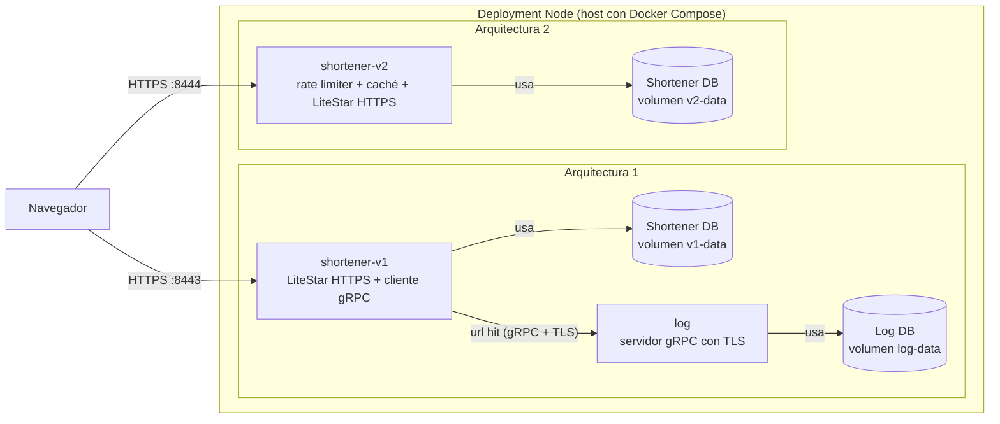
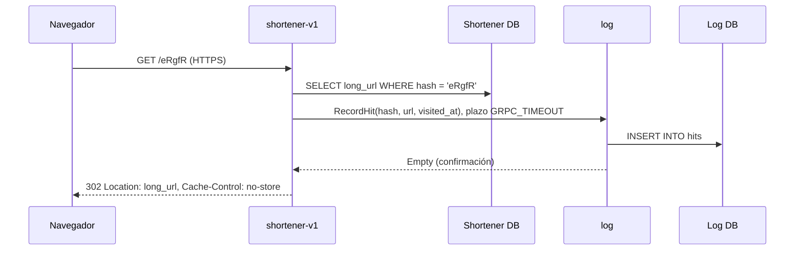
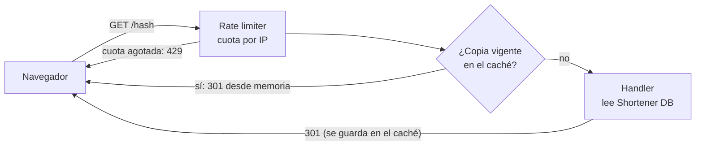

# Diseño de las arquitecturas

Este documento describe el diseño implementado de ambas arquitecturas: qué componente corresponde a cada elemento de las figuras del enunciado, cómo se comunican, qué contratos respetan y qué ocurre ante fallas. El [README](../README.md) explica cómo ejecutarlas y [la discusión de trade-offs](tradeoffs.md) evalúa sus consecuencias para la USM.

## Correspondencia con el enunciado

Docker Compose despliega todos los servicios en un mismo host, que corresponde al *Deployment Node* de las figuras 1 y 2. Ambas arquitecturas usan la misma imagen; la variable `ARCHITECTURE` decide si el proceso arma la arquitectura 1 (`create_v1_app`) o la 2 (`create_v2_app`).

| Elemento de la figura | Servicio de Compose | Implementación |
| --- | --- | --- |
| Shortener v1 `<<http_endpoint>>` `<<grpc_client>>` (figura 1) | `shortener-v1`, HTTPS en el puerto 8443 del host | `shortener/app.py` (`create_v1_app`) y `shortener/analytics.py` (cliente gRPC) |
| Log `<<grpc_service>>` (figura 1) | `log`, gRPC con TLS en el puerto 50051 de la red interna | `shortener/log_service.py` |
| Shortener DB (figura 1) | Volumen `v1-data` | SQLite, `SQLiteURLRepository` en `shortener/storage.py` |
| Log DB (figura 1) | Volumen `log-data` | SQLite, `SQLiteHitRepository` en `shortener/storage.py` |
| Shortener v2 `<<http_endpoint>>` (figura 2) | `shortener-v2`, HTTPS en el puerto 8444 del host | `shortener/app.py` (`create_v2_app`) |
| Shortener DB (figura 2) | Volumen `v2-data` | SQLite, `SQLiteURLRepository` |
| Fuera de las figuras: certificados | `certificates`, servicio que termina después de generarlos | `shortener/certificates.py` |

## Contrato HTTP común

Ambas arquitecturas exponen la misma API. `POST /urls` recibe `{"long_url": "..."}` y responde 201 con `id`, `hash`, `long_url` y `short_url`. `GET /{hash}` responde con la redirección de cada arquitectura, o con 404 si el hash no existe. `GET /health` informa el estado del servicio y no cuenta para el rate limiter.

La URL larga debe ser HTTP o HTTPS. Pydantic la normaliza antes de guardarla: el esquema y el host quedan en minúsculas, un dominio no ASCII pasa a punycode y los caracteres no ASCII del camino se codifican con porcentaje. Como esa codificación puede alargar la URL, el acortador aplica el límite de 2083 caracteres a la URL normalizada, que es el mismo límite con que Log valida el evento. Así, toda URL que el acortador acepta también la acepta Log. El acortador rechaza además, con 400, las URLs de su propio origen (`PUBLIC_BASE_URL`), porque un enlace hacia sí mismo produciría un bucle de redirecciones y, en la arquitectura 1, un evento por cada salto.

Cada `POST` crea un registro nuevo, aunque la URL larga ya exista. SQLite asigna el `id` con una secuencia que comienza en 597652313 y aumenta de uno en uno, y el `hash` es la codificación base62 de ese `id`, con el alfabeto de pybase62, calculada en la misma transacción que la inserción. Base62 asigna una cadena distinta a cada número, así que los hashes son únicos dentro de cada base. Como son consecutivos, también son predecibles: conocer un enlace permite adivinar los siguientes.

## Arquitectura 1: redirección temporal con registro de visitas

Al recibir `GET /{hash}`, el acortador busca la URL en Shortener DB, envía a Log el evento `url hit` y espera su confirmación antes de responder 302 con `Cache-Control: no-store`. La espera tiene un plazo de `GRPC_TIMEOUT` segundos.

El contrato gRPC está en `proto/shortener/rpc/hits.proto`. El evento tiene tres campos:

| Campo | Contenido | Origen |
| --- | --- | --- |
| `hash` | Hash base62 del enlace corto visitado. Distingue enlaces distintos que llevan al mismo destino. | Shortener DB |
| `url` | URL larga normalizada, la misma que va en la cabecera `Location`. | Shortener DB |
| `visited_at` | Hora UTC en que el acortador resolvió el enlace, como `google.protobuf.Timestamp`. Log la guarda en ISO 8601. | Reloj del acortador |

Log rechaza con `INVALID_ARGUMENT` un evento sin un hash base62, sin una URL HTTP válida de hasta 2083 caracteres o sin timestamp. Cada evento aceptado queda como una fila de la tabla `hits` (`id`, `hash`, `url`, `visited_at`), indexada por `hash`. Si Log encuentra una Log DB creada antes de que el evento incluyera el hash, agrega la columna y conserva las visitas anteriores con el hash vacío.

### Comportamiento ante fallas

| Situación | Respuesta de la arquitectura 1 |
| --- | --- |
| Log confirma el evento | 302 con `no-store`. |
| Log detenido o sin responder | El acortador espera hasta `GRPC_TIMEOUT` y responde 503 (`The visit could not be recorded`). `/health` también responde 503. En el despliegue con Docker, ambos casos tardaron los 2 s del plazo, porque al detener el contenedor la conexión no se rechaza: queda sin respuesta. |
| Log rechaza el evento | 503. El acortador valida las URLs con las mismas reglas antes de guardarlas, así que este caso no debería ocurrir con datos creados por la API. |
| Log confirma después del plazo | El usuario recibe 503, pero el evento queda registrado. Log descarta el evento si, antes de escribirlo, detecta que el acortador dejó de esperar; no puede evitar el caso en que la escritura termina justo después del plazo. La prueba `test_grpc_timeout_can_be_followed_by_a_committed_event` reproduce este caso. |
| Hash inexistente | 404, sin enviar evento. |

Los handlers de LiteStar se ejecutan en un grupo de 40 hilos. Mientras Log no responde, cada visita ocupa un hilo hasta que vence el plazo, así que también se demoran la creación de URLs y `/health`. La discusión de trade-offs evalúa esta consecuencia.

### Cómo observar los eventos

Log escribe una línea por cada evento aceptado (`url hit recorded: hash=... url=... visited_at=...`), visible con `docker compose logs log`. El comando `docker compose exec log python -m shortener.hits_report` abre la Log DB en modo de solo lectura y muestra las visitas por enlace corto y las últimas registradas. Cuando Log no confirma una visita, `shortener-v1` registra una advertencia con el código gRPC (por ejemplo, `DEADLINE_EXCEEDED`).

## Arquitectura 2: redirección permanente con rate limiter y caché

Cada petición pasa primero por el rate limiter de LiteStar, después por el caché de respuestas y, solo si el caché no tiene una copia vigente, llega al handler que consulta Shortener DB. La respuesta es un 301 con `Cache-Control: public, max-age=CACHE_TTL`.

El rate limiter implementa la táctica *controlar arribo de eventos*. Admite `RATE_LIMIT_REQUESTS` peticiones por IP en una ventana fija de un minuto, que empieza con la primera petición de esa IP. Al agotar la cuota responde 429. Todas las respuestas incluyen las cabeceras `RateLimit-Limit`, `RateLimit-Remaining` y `RateLimit-Reset`. Como el limitador va antes del caché, también las respuestas cacheadas consumen cuota. LiteStar identifica al cliente por la IP de la conexión y no lee `X-Forwarded-For`.

El caché implementa la táctica *mantener múltiples copias de datos*. Guarda solo respuestas 301, durante `CACHE_TTL` segundos, con la ruta como clave: los parámetros de consulta no cambian la redirección y, con la clave por defecto de LiteStar, cada variante crearía una copia nueva. Los 404 no se guardan, de modo que un hash creado después de una consulta fallida queda disponible de inmediato. El handler escribe `Resolved <hash> from Shortener DB` cada vez que consulta la base; las visitas servidas desde el caché no producen esa línea, lo que permite comprobar el caché con `docker compose logs shortener-v2`.

El caché y las cuotas viven en la memoria del proceso (`MemoryStore`). Se pierden al reiniciar el servicio, y cada réplica tendría los suyos. `MemoryStore` solo descarta una entrada vencida cuando se vuelve a leer su clave, así que el servicio purga las entradas vencidas cada 60 segundos para que no se acumulen los hashes y las IPs ya vistos.

## Despliegue y seguridad de las conexiones

El servicio `certificates` genera, antes que los demás, una CA local y un certificado de servidor firmado por ella. El certificado vale para `localhost`, `127.0.0.1`, `log`, `shortener-v1` y `shortener-v2`, dura 30 días y se regenera al levantar los servicios si le queda menos de un día. Uvicorn sirve HTTPS con ese certificado, el cliente gRPC verifica a Log con la CA y los healthchecks de Compose también usan TLS. Los certificados no son reconocidos por el navegador, como permite el enunciado.

Compose levanta `log` antes que `shortener-v1` y espera a que esté saludable; `shortener-v2` no depende de `log`. Los contenedores se ejecutan con un usuario sin privilegios (UID 10001), y los stubs gRPC se generan durante la construcción de la imagen a partir del archivo `.proto`.

## Decisiones de diseño

| Decisión | Alternativa | Motivo | Consecuencia |
| --- | --- | --- | --- |
| La arquitectura 1 espera la confirmación de Log antes de responder 302. | Responder sin esperar y enviar el evento después, por ejemplo con una cola. | Cada 302 entregado tiene su evento registrado. Es la consistencia inmediata que caracteriza a una llamada RPC síncrona. | La latencia y la disponibilidad de la redirección dependen de Log; la discusión de trade-offs lo evalúa. |
| El evento lleva el hash, la URL larga y la hora. | Solo la URL y la hora. | La URL larga no distingue enlaces cortos distintos hacia el mismo destino, como los de una misma campaña difundida por varios canales. | Log puede contar las visitas de cada enlace corto. |
| Una base SQLite por componente. | Un servidor de base de datos compartido. | Las figuras muestran una base por componente, y SQLite no agrega servicios al despliegue. | Cada base admite un escritor a la vez, y las secuencias de `id` de ambas arquitecturas son independientes (ver el bonus en la discusión). |
| `id` autoincremental desde 597652313 y `hash` igual a base62 del `id`. | Hash de la URL o identificadores aleatorios. | Lo pide el enunciado, y base62 garantiza hashes únicos cuando los `id` son únicos. | Los hashes son cortos, pero consecutivos y predecibles. |
| TLS también entre `shortener-v1` y `log`. | gRPC sin cifrar dentro de la red de Compose. | El enunciado pide conexiones seguras, y la misma CA sirve para HTTPS y gRPC. | Hay que generar y distribuir certificados, lo que hace el servicio `certificates`. |
| Caché solo de respuestas 301, con la ruta como clave. | La clave por defecto de LiteStar, que incluye los parámetros de consulta. | Los parámetros no cambian la redirección y no deben multiplicar las copias. | Un hash creado después de un 404 no queda oculto por el caché. |
| Rate limiter por IP, antes del caché. | Una cuota global o por usuario autenticado. | Es la configuración disponible en LiteStar, y la API no tiene usuarios. | Los clientes que comparten una IP (Docker, NAT, proxy) comparten una cuota. |
| Caché y cuotas en la memoria del proceso. | Un almacén compartido, como Redis. | Hay un solo proceso y no se agregan servicios. | Se pierden al reiniciar y no se comparten entre réplicas. |
| Una imagen con dos fábricas de aplicación. | Dos bases de código. | Ambas arquitecturas comparten la creación de URLs, la validación y la salud, y difieren en la redirección, Log, el caché y el rate limiter. | Las diferencias de cada arquitectura quedan en `create_v1_app` y `create_v2_app`. |
