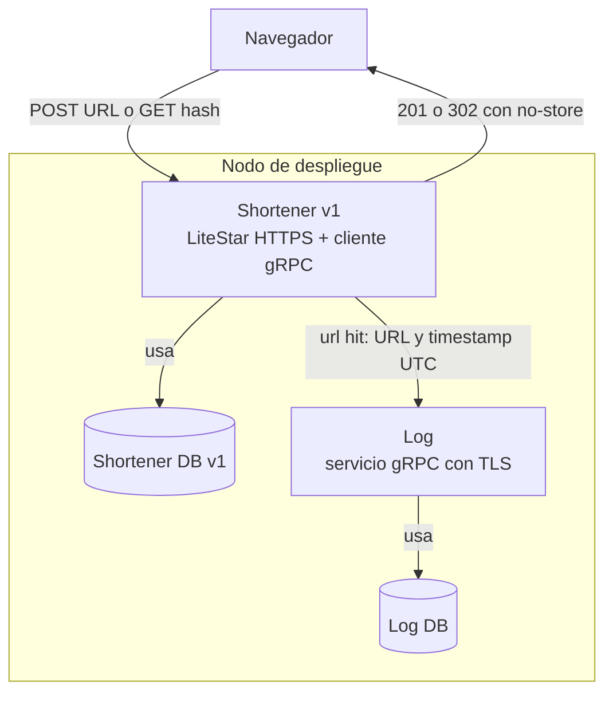
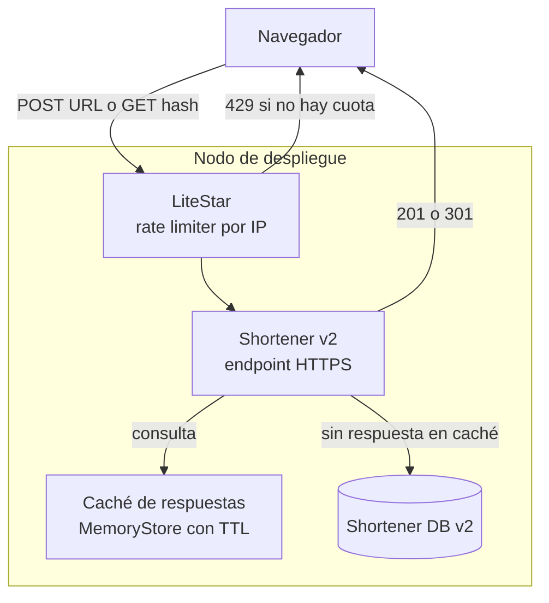

# Arquitectura implementada

Cada arquitectura usa su propia base SQLite. Docker Compose representa el nodo de despliegue del enunciado, con servicios separados que comparten una red interna y certificados locales.

## Arquitectura 1

Versión textual:

```text
Nodo de despliegue
|
+-- Shortener v1 [Python, LiteStar, endpoint HTTPS, cliente gRPC]
|   +-- usa --> Shortener DB v1 [SQLite, volumen persistente]
|   +-- usa gRPC con TLS --> Log
|
+-- Log [Python, servicio gRPC]
    +-- usa --> Log DB [SQLite, volumen persistente]
```



`POST /urls` valida la URL y confirma una transacción antes de devolver la equivalencia. `GET /{hash}` consulta la base, envía el evento y espera confirmación del servicio de registro antes de responder 302. Cada visita vuelve a ejecutar este flujo. Un hash inexistente devuelve 404; una falla de registro devuelve 503.

El contrato está en `proto/shortener/rpc/hits.proto`: `RecordHit` recibe `url` y `visited_at` y devuelve `google.protobuf.Empty` tras persistirlos. Los archivos Python generados se crean dentro de la imagen y no se versionan.

## Arquitectura 2

Versión textual:

```text
Nodo de despliegue
|
+-- Shortener v2 [Python, endpoint HTTPS de LiteStar]
    +-- controla arribo de eventos --> rate limiter por IP y minuto
    +-- mantiene copias de datos --> caché de respuestas 301 con TTL
    +-- usa --> Shortener DB v2 [SQLite, volumen persistente]
```



El middleware limita las peticiones antes de servir una respuesta, incluida una respuesta cacheada. El decorador de LiteStar habilita el caché en el GET y un filtro acepta exclusivamente respuestas 301. No se cachean creaciones ni errores. El TTL predeterminado es 60 segundos, tanto en el servidor como en `Cache-Control`.

El caché evita consultar repetidamente SQLite; el caché del navegador puede evitar incluso contactar al servicio. V2 no necesita el contenedor de registro para funcionar.

## Dependencias y almacenamiento

`ShortenerService` recibe un `URLRepository`, un `HitLogger` opcional y un reloj sustituible. La fábrica `create_app` recibe configuración y adaptadores, e inyecta el servicio mediante `Provide` de LiteStar. Las pruebas pueden sustituir esas dependencias sin abrir conexiones a servicios externos.

Los identificadores se asignan en SQLite desde `597652313`; su codificación base62 usa el alfabeto `0123456789ABCDEFGHIJKLMNOPQRSTUVWXYZabcdefghijklmnopqrstuvwxyz`. La inserción y el cálculo del hash pertenecen a la misma transacción, de modo que no se publica una equivalencia incompleta.

La CA, el certificado y la clave de servidor se generan en un servicio de inicialización. Los servicios HTTP y gRPC verifican o presentan los certificados correspondientes. Los procesos de ejecución usan el UID 10001 y los certificados se montan como solo lectura en los servidores.

## Referencias de implementación

- [Inyección de dependencias en LiteStar](https://docs.litestar.dev/latest/usage/dependency-injection.html).
- [Caché de respuestas en LiteStar](https://docs.litestar.dev/latest/usage/caching.html).
- [Rate limiter de LiteStar](https://docs.litestar.dev/latest/reference/middleware/rate_limit.html).
- [Integración de uv con Docker](https://docs.astral.sh/uv/guides/integration/docker/).
- [Servicios Python con gRPC](https://grpc.io/docs/languages/python/quickstart/).
